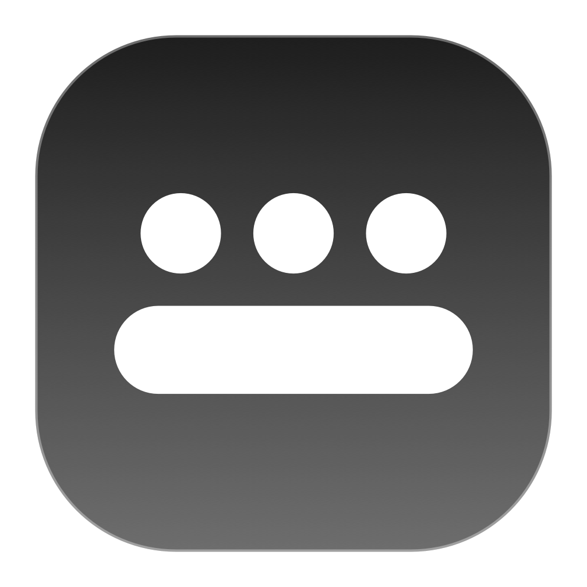

# DockUtils

Small utilities for the macOS Dock:

- **Dock shortcuts:** hold **Option** to overlay numbered glass badges on your Dock icons, then press a number to switch to that app — a minimal, keyboard-first app switcher.
- **Dock copies:** optionally, a copy of the Dock on every other display, with zoomed and tiled windows kept clear of it.

Formerly DockShortcuts (`dock-shortcuts-mac`).


## How it works

1. Hold **Option** — frosted number badges appear beside each running app's Dock icon (100 ms delay, so quick `Option+letter` combos stay clean).
2. Press **1–9**, **0** (0 = 10th app) — the matching app activates, or hides if it's already frontmost. If the app has multiple windows open, repeat presses cycle through its windows instead of hiding.
3. Release **Option** — badges disappear.

Badge placement follows the Dock automatically (left / right / bottom) based on icon geometry.

## Dock copies on other displays

Optional, off by default: **Settings → Other Displays → Copy the Dock to other displays** (or `dock_copies: true`) puts a copy of the Dock on every display the real Dock isn't on, like ExtraDock's Live Dock.

- Same items in the same order (apps, separator, folders, Trash), with running indicators, badges (unread counts) and hover labels. Matches the Dock's position (bottom/left/right), icon size and auto-hide.
- Clicking an app presses the real Dock item, so it launches, activates or un-minimizes exactly like a Dock click. Folders and Trash open in Finder.
- Follows Dock changes, display connect/disconnect and rearrangement, and the real Dock moving between displays.
- The number badges (hold Option, or always visible) show on the copies too, so Option+number works from whichever display you're looking at.
- **Keep windows clear of the copies** (on by default): zoomed, filled and tiled windows stop at a copy's edge, as they do at the real Dock.

How windows are kept clear: the real Dock reserves space by shrinking `NSScreen.visibleFrame`, and there's no public API to reserve more. SkyLight's private `SLSSetDockRectWithReason` does shrink another display's `visibleFrame`, but it's a single global rect shared with the real Dock, so it can't serve more than one copy. Instead, DockUtils watches other apps' windows through Accessibility (`kAXWindowResizedNotification`) and, once a resize settles, shrinks a window whose edge is at (or within a 16 pt tiling margin of) the screen edge under a copy. Moves are left alone, so you can still drag windows over a copy. The catch: the window first animates under the copy, then snaps back about 0.15 s later.

Limitations: minimized windows aren't mirrored, folders don't pop up as stacks, and there's no magnification, bounce, progress bars, drag and drop or right-click menus.

Under the hood: Dock icon positions come from the Accessibility API (`AXDockItem` elements of the Dock process), key interception via `CGEventTap`, badges are borderless `NSPanel`s with `NSVisualEffectView`.

## Requirements

- macOS 14+
- Swift toolchain (`xcode-select --install` is enough; full Xcode not required)
- **Accessibility permission**: the app needs it to read Dock icon positions and listen for the Option key, and for Dock copies to press Dock items and resize other apps' windows. Grant it in `System Settings → Privacy & Security → Accessibility` for your terminal (or the built binary) on first run.

## Build

```sh
swift build
```

## Install a released version

Via Homebrew:

```sh
brew tap kovacsgellert/tap
brew install --cask dock-utils
```

Or manually:

1. Download `dock-utils-<version>-macos-arm64.dmg` from the [Releases page](https://github.com/kovacsgellert/dock-utils-mac/releases), open it, and drag **DockUtils** into **Applications**. (Prefer a guided install? Use `dock-utils-<version>-macos-arm64.pkg` instead — it puts the app into `/Applications` automatically.)
2. Neither is notarized, so Gatekeeper blocks the first launch. On macOS 15 (Sequoia) and later, try to open the app once, then go to `System Settings → Privacy & Security`, scroll down and click **Open Anyway**. On macOS 14, right-click the app and choose **Open** instead.
3. Grant Accessibility permission when prompted (`System Settings → Privacy & Security → Accessibility`).
4. A settings window opens on first launch: toggle **Start automatically when you log in** if you want it always running. The window can be reopened anytime from the menu-bar icon.

### Updating

Update with `brew upgrade --cask dock-utils`, or by dragging the new version over the old one in Applications. Releases are signed with the same certificate, so the Accessibility permission carries over.

Coming from DockShortcuts: DockUtils is a new app as far as macOS is concerned (new name and bundle id `com.kovacsgellert.dock-utils`). Your `~/.config/dock-shortcuts/config.yml` is copied over on first launch. Grant Accessibility to **DockUtils**, then remove the old **DockShortcuts** entry there with **−** and delete `DockShortcuts.app` if it's still in Applications.

### Releasing

Releases are built automatically: pushing a version tag like `0.1.0` triggers the `Release` workflow, which packages the `.app`, builds the DMG, and attaches it to the GitHub Release.

Releases are signed with a self-signed certificate (no paid Apple Developer ID), stored in the `SIGNING_P12_BASE64` and `SIGNING_P12_PASSWORD` repository secrets. A stable signature is what lets macOS keep the Accessibility permission across updates; ad-hoc signatures change with every build. The workflow refuses to publish a release without it. The certificate is shared by all of the author's Mac apps (macOS keys permissions on bundle id + certificate, so apps stay separate); it was created once with `scripts/make-signing-cert.sh` into `~/.codesign/`. Keep its `.p12` and password backed up: a new certificate means every user has to grant Accessibility again. To sign a local build the same way, run `SIGNING_P12=<path> SIGNING_P12_PASSWORD=<password> ./scripts/package-app.sh`.

## Configuration file

Settings live in `~/.config/dock-utils/config.yml` — plain `key: value` pairs, safe to edit by hand or manage with scripts across machines. If `XDG_CONFIG_HOME` is set, `$XDG_CONFIG_HOME/dock-utils/config.yml` is used instead.

```yaml
start_at_login: false
show_menu_bar_icon: true
appearance: system  # system | light | dark
badge_delay_ms: 100  # 0...500
badges_always_visible: false  # persistent mini-badges on Dock icons
dock_copies: false  # copy the Dock onto your other displays
dock_copies_on_dock_display: false  # also on the real Dock's display
dock_copies_keep_windows_clear: true  # shrink zoomed/tiled windows out of the copies
```

The file is created on first launch (existing installs migrate their current settings into it). Hand edits apply as soon as the file is saved, no relaunch needed. Everything is also editable from the settings window.


## Usage

List running Dock apps and their badge numbers:

```sh
swift run dock-utils --list
```

Activate an app by number (same as pressing it while holding Option):

```sh
swift run dock-utils --activate 2
```

Run the daemon (hold Option to badge, press a number to switch, `Ctrl+C` to quit):

```sh
swift run dock-utils --daemon
```

## AI usage disclosure

This app is completely vibe-coded — designed and written with an AI coding assistant, no hand-written code.

## License

MIT — see [LICENSE](LICENSE).

